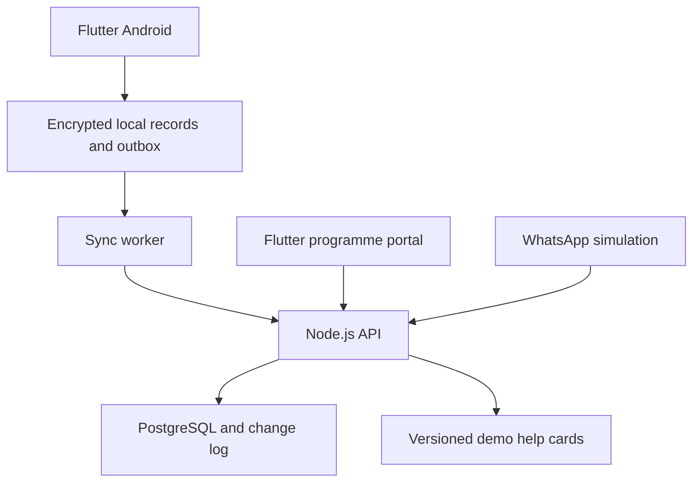

# Architecture and synchronisation

## Build choices

Use one repository with apps/mobile, apps/portal, services/api, packages/ui, packages/domain, and docs. Share Dart design components and pure domain formatting between Flutter targets. Keep native database dependencies in the mobile target. Use REST JSON between Flutter and the Node.js service.

| Component | Decision |
| --- | --- |
| Mobile | Flutter stable, Dart, Riverpod for state and repository injection, go_router for navigation |
| Portal | Flutter web, shared UI tokens, online API repositories |
| API | Node.js supported LTS, TypeScript, Fastify, schema validation |
| Database | PostgreSQL, SQL migrations, pg driver and explicit transactions |
| Mobile data | Drift, encrypted native SQLite, platform secure storage for the database key and demo session |
| Sync | A narrow application-owned outbox and incremental download protocol for this demo |
| Local startup | Docker Compose for API and PostgreSQL, Flutter toolchain for clients |

These are specification decisions for the prototype. Pin compatible package versions during setup and record them. Research identified PowerSync as a production candidate. This demo deliberately has one sync implementation with a small operation vocabulary, making its behaviour inspectable. Any later substitution must pass the same acceptance suite.

## Logical flow

The outbox is the durable source for unsent intent. Canonical local tables mirror accepted server records. A pending overlay is calculated from unresolved local operations and shown separately. Accepted operations are deduplicated by operation ID when they appear in downloaded data.

## Local save atomicity

In one SQLite transaction, store the complete operation payload, actor ID, subject ID, dataset ID, payload hash, creation timestamp, and local sequence number. Store any linked local form state in that same transaction. Show success after commit. Repeated taps reuse the form submission identity until its result is known.

New operation IDs are UUIDs generated once. A network retry retains the original ID and payload. An edit to an unsent draft replaces the draft before it becomes an operation. A rejected submission can be replaced through an explicit correction action that creates a new operation ID and links the rejected one.

## Operation state machine

| State | Meaning | Allowed next states |
| --- | --- | --- |
| pending | Stored locally and eligible for dispatch | sending, discarded, superseded for a never-dispatched nonfinancial edit |
| sending | Network attempt in progress | acknowledged, retry_wait, blocked, conflict, rejected |
| retry_wait | Temporary network or server failure | sending, discarded when delivery is known to be absent |
| blocked | Expired session, unmet dependency, or dataset mismatch | pending after the relevant condition is repaired |
| conflict | Server requires current-version review | superseded or pending for an unchanged retry after an identified transient dependency |
| rejected | Definitive validation or permission failure | superseded or archived |
| acknowledged | Server accepted the operation and returned canonical records | terminal |
| superseded | User replaced the rejected/conflicted intent | terminal |
| discarded | Unsent intent explicitly abandoned | terminal |

On startup, change interrupted sending operations to pending. The server's idempotency record handles ambiguity. Once an operation might have reached the server, resolve its receipt status before offering discard. Confirmed financial records use the reversal workflow for correction.

For repeated profile or attendance edits while offline, atomically supersede a never-dispatched pending intent and enqueue the new intent with a new operation ID and the same last-confirmed expectedVersion. Preserve the superseded record for local diagnostics. Track hasEverDispatched separately from the current state. If delivery could have occurred, reconcile the receipt before another edit to that record; do not reuse a potentially stale expectedVersion silently. This rule prevents consecutive local edits conflicting with their own unsent predecessor. Financial entries do not use this coalescing rule.

## Upload protocol

Run one worker per local actor/dataset. Order operations by local sequence and dependencies. Use one in-flight mutation at a time. A blocked dependency holds its descendants while unrelated later work can continue. Registration-dependent financial entry is deferred until the registration is confirmed in this prototype.

Every request includes datasetId and operationId. The API derives actorId and group access from the session. It validates the shape, relationship consistency, permissions, and business rules.

Inside a PostgreSQL transaction, lock the single dataset sync_clock row first. For this small demo that serialises accepted writes and makes commit order match change-cursor order. Then obtain any required meeting/member/loan row locks in a stable order. Check the idempotency key and compare a canonical payload hash. Apply the mutation, write an audit event, store its receipt, allocate the next change cursor, append the changed records, and commit together.

The receipt key is unique on datasetId, actorId, operationId. The same key and hash returns the stored result. The same key with a changed payload returns OPERATION_ID_REUSED. Apply current authorization before returning a stored receipt. This protocol provides one business effect per accepted operation under retries. It does not make the network itself an exactly-once transport.

A financial entry needs both operation identity and a stable transactionId. Enforce transactionId uniqueness within the dataset, and reject reuse with incompatible content. This second check catches client defects creating a new operation for the same transaction.

## Incremental download

Bootstrap runs in a repeatable-read transaction. Return an authorised snapshot, datasetId, and its matching committed cursor. Initial download must install snapshot and cursor atomically on the device. Bootstrap is required while connected before offline use.

For GET /v1/changes, capture a committed high-water cursor. Scan at most the configured number of raw change events up to that watermark, filter records by current actor scope, and return nextCursor equal to the last scanned cursor. An empty visible result can still advance the cursor. Continue while hasMore is true. This avoids stalling on changes belonging to another group.

Install each returned page and its cursor in one SQLite transaction. Canonical upserts include the originating operation ID where available, allowing pending effects to disappear even when upload acknowledgement was lost. Acknowledged receipts also return changed records, so the normal path updates immediately. Applying the same record twice is harmless by its ID and version.

The demo keeps its change log for the life of the dataset. Dataset reset changes datasetId, invalidates sessions, and requires an explicit local reset. A mismatch must leave pending data visible for review. Display the count that would be discarded before a user resets local demo data.

## Concurrency and financial integrity

- Profile and attendance edits carry expectedVersion. A mismatch returns currentVersion and currentRecord for explicit review.
- Each financial posting locks its meeting and applicable loan. Validate that the meeting is open, the member belongs to its group, and the actor is assigned to that group.
- A financial posting increments meeting.version. Submit meeting carries the latest expectedVersion and requires online confirmation after sync.
- Repayments reduce outstanding principal only after acceptance. Revalidate against all accepted repayments while holding the loan lock.
- Once submitted, a meeting rejects new mobile postings. The manager correction endpoint is online and records a linked reversal.
- Reversal is full-amount only in the demo. Enforce one reversal per original transaction and require a reason. Mark the original as reversed and recompute aggregates from effective transactions.
- Use integer paise throughout. Aggregate SQL results are validated to fit the API's documented safe-integer range.

## Authentication and devices

Demo login offers fixed synthetic identities behind a server-configured demo access code. Store only its hash server-side. Rate-limit attempts. Issue an opaque cryptographically random session token with an eight-hour expiry, store its hash in the database, and return an offlineUntil timestamp of the same expiry. The actor-to-group mapping is server-owned.

The mobile app can read cached records and save permitted local operations within that lease. After expiry it locks record access and retains encrypted pending operations until reauthentication as the same actor. All server calls validate an active session. A role switch or logout clears displayed records and prevents the new actor opening the old actor's data. Block logout when ambiguous pending delivery exists until receipt reconciliation or explicit demo reset.

Each actor/dataset has a separate encrypted local database and secure-storage key. Generate the key on device. Verify that the encrypted SQLite build is actually used. Opening the file with an unkeyed reader must fail. Diagnostic logs contain references and error codes rather than access codes, tokens, or participant fields.

Bind the local API through an explicitly configured interface. Android emulator access commonly uses the host loopback alias supported by its environment, while physical devices require an approved LAN route. Restrict any HTTP cleartext exception to the development build. Hosted access requires HTTPS, a restricted audience, and server-managed demo access. Production mode disables demo auth, simulation ingestion, reset, and fault controls.

## Connectivity and observability

Trigger sync after a local save when the API is reachable, on foreground entry, on connection restoration, and on a user retry. Use capped exponential backoff with jitter for transport errors and retryable server failures. Connectivity signals are hints. The API request establishes actual reachability.

Display queued count, last successful API contact, last accepted record time, and actionable failures. An offline phone's unsent queue is known locally. Portal queue counts are labelled Last reported by device and carry a timestamp. They can be stale. Server records alone cannot reveal operations that have never arrived.

## Attachments and deployments

The required demo uses text and bundled media. Reserve an attachment interface without implementing upload storage in P0/P1. Production file uploads would use bounded, controlled object access with separate retry state.

Provide container build files, a migrations command, health endpoints, and environment examples with placeholders. Production hosting belongs in TUIF's AWS account and is subject to its architecture approval. Document the mapping to managed PostgreSQL, object storage, and a Node.js runtime without provisioning those services during this task.
